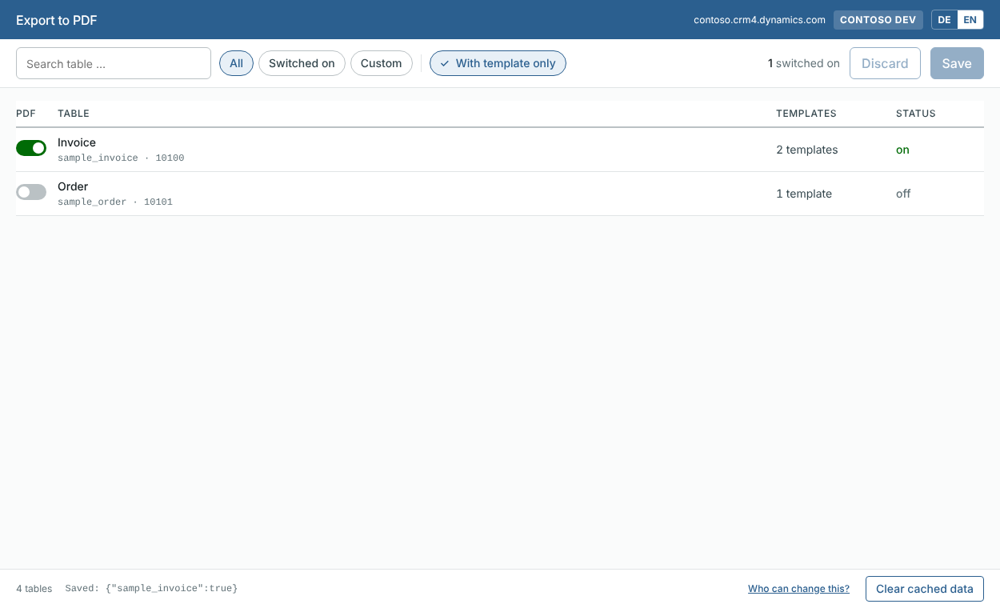

# Dataverse PDF Export Switch

A single web resource for Microsoft Dataverse that shows which tables have
**Export to PDF** enabled and lets administrators switch it per table.



## Why this exists

Dataverse can render Word templates as PDF, but the switch that decides which
tables get the **Export to PDF** command is awkward to reach. Microsoft
documents it only for Dynamics 365 Sales, where it sits under App Settings →
Convert to PDF, and the documentation lists only the seven sales tables. In an
environment without Sales, that settings page is hard to reach and often loads
empty.

The setting itself lives in the `pdfsetting` table, in a column called
`pdfsettingsjson`. It holds one JSON object with an entry per table:

```json
{ "quote": true, "sample_invoice": true }
```

This tool reads that record, shows it next to the list of tables and their Word
templates, and writes it back.

## What it does

- Lists every non-private table in the environment with display name, object
  type code and the number of activated Word templates attached to it. Excel
  templates do not produce a PDF and are not counted; templates still in draft
  are shown separately, because they do not reach users
- Switches the export on or off per table; several tables in one save
- Search plus filters: all, switched on, custom tables, with template only
  (on by default — a table without a template produces an empty picker)
- Warns about tables that are switched on without a template, and about
  entries that point at tables which no longer exist
- Refuses to save when there is no setting record, when there is more than
  one, or when the stored value is not a JSON object of boolean entries
- Writes with the record's ETag. If another administrator changed the setting
  in the meantime, the save is rejected rather than overwriting their change:
  the list reloads, your selection is kept, and saving again merges both. If
  the read returns no ETag at all, saving is blocked instead of falling back
  to an unconditional write
- Locks the toggles, the save and the discard button while a save is in
  flight — the lock is part of the state, so a redraw from the search box or
  a filter does not lift it — and keeps a change that still lands during the
  save instead of discarding it with the rest
- Checks whether the current user may write, and lists the security roles that
  hold the privilege. The dialog distinguishes three answers: allowed, not
  allowed, and could not be determined
- Clears the browser caches for this environment, so the command bar picks up
  the change without clearing browser data globally. The dialog names what it
  found and lets each group be deselected. Only the cache entries are
  pre-selected; local databases and service workers are not, and the dialog
  says when to tick the databases. What is pre-selected is decided by
  `CACHE_DEFAULTS` near the top of the script — one line if your policy
  differs
- German and English, chosen from the browser language, switchable

## Requirements

- A Dataverse environment with at least one `pdfsetting` record (environments
  normally ship with one)
- Write access to `pdfsetting` for anyone who should change the setting — in
  practice System Administrator or System Customizer. Read access is enough to
  look
- At least one activated Word template per table you switch on, otherwise the
  command appears with an empty list

## Installation

1. Create a solution, or use an existing one.
2. Add three web resources:

   | File | Name | Type |
   | --- | --- | --- |
   | `src/exporttopdf.html` | `<prefix>_exporttopdf.html` | Webpage (HTML) |
   | `src/exporttopdf.css` | `<prefix>_exporttopdf.css` | Style Sheet (CSS) |
   | `src/theme.css` | `<prefix>_theme.css` | Style Sheet (CSS) |

   Your publisher prefix is added by Dataverse. Because of that, update the two
   `<link>` tags at the top of `exporttopdf.html` to the names the web
   resources actually got.

3. Publish the solution.
4. Open `https://<your-org>.crm.dynamics.com/WebResources/<prefix>_exporttopdf.html`,
   or add the HTML web resource as a subarea in a model-driven app's sitemap.

### After switching a table on

The command bar caches which tables support PDF for the session. Use **Clear
cached data** at the bottom right, then close the app tab and open it again.
The command then appears as **Export to PDF**; on a narrow command bar it hides
under **More commands**.

If the old state is still there afterwards, clear again and tick **local
databases** as well. That step is not pre-selected because unsynced offline
data of that browser profile would be lost with it.

## Theming

`src/theme.css` carries neutral tokens and a small set of components
(`.x-table`, `.x-btn`, `.x-chip`, `.x-alert`, `.x-dots`, `.x-empty`). Override
the custom properties in `:root` to match your own design system — the markup
does not need to change. If the theme file fails to load, the tool says so
instead of rendering half-styled.

## Tests

The suite drives the page in Chromium against a mocked Dataverse Web API. No
environment is needed.

```bash
npm ci
npx playwright install chromium
npm test
```

Node 22 or newer. 101 checks cover loading, filters, saving without data loss,
every guard, concurrent writes, a change made while a save is in flight, the
privilege check with the privilege type as text, as number and missing,
paging, both languages, the theme fallback, and a set of static checks on the
source itself — that every CSS class used has a rule, that no inline style
sits outside the theme fallback, and that neither language's texts contain
leftovers from the other.

## Notes and limitations

- Microsoft does not document write access to `pdfsetting`. The table is a
  normal Dataverse table and the Sales settings page writes the same column,
  but a platform change could affect this tool. Test in a development
  environment first.
- `pdfsetting` is not a solution component. The setting does not travel with a
  solution; each environment is switched separately.
- The production marker is a heuristic: the environment name is matched
  against `prod`, `prd` and `live`. Dataverse does not expose the environment
  type here.
- The tool deliberately does not create a missing `pdfsetting` record. That is
  the only step that would add data, and it should not happen by accident.
- Clearing cached data works on the whole origin, which is shared by every
  model-driven app in the environment: the browser has no per-app partition
  for it. The dialog therefore lists what it found and lets each group be
  deselected. Unsynced offline data would be lost. A database another tab
  holds open cannot be deleted; that is reported as not confirmed rather than
  counted as cleared. Firefox does not expose the list of local databases, so
  the button cannot clear them there.
- The privilege check is advisory. When it cannot be answered — for example
  because the user may not read security roles — the tool stays writable and
  lets the server decide, instead of locking out an administrator on a failed
  lookup. Dataverse enforces the privilege either way, and the dialog says
  that the answer is unknown rather than claiming it is a refusal.
- Which browser store holds the command bar's table list is not documented.
  Microsoft's own advice after regenerating ribbon metadata is to "clear your
  browser cache", without naming a store. The dialog therefore clears cache
  storage by default and offers local databases as an explicit second step,
  rather than deleting more than necessary on a guess.

## License

MIT — see [LICENSE](LICENSE). Copyright (c) 2026 Ayonto UG
(haftungsbeschränkt).

Developed and published by Ayonto UG (haftungsbeschränkt), Berlin —
[ayon.to](https://ayon.to) · [Impressum](https://ayon.to/impressum).
